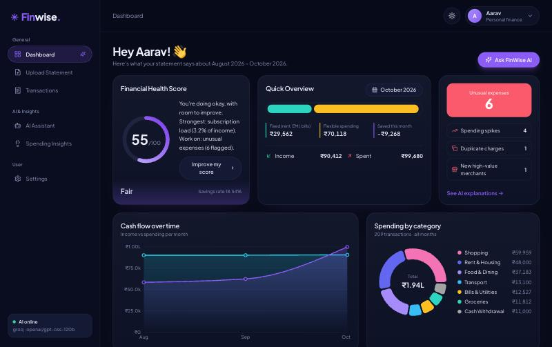
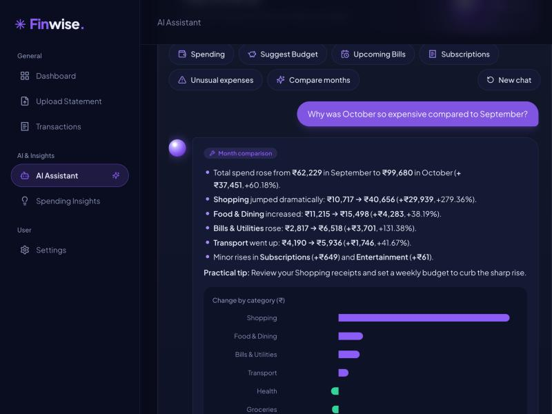
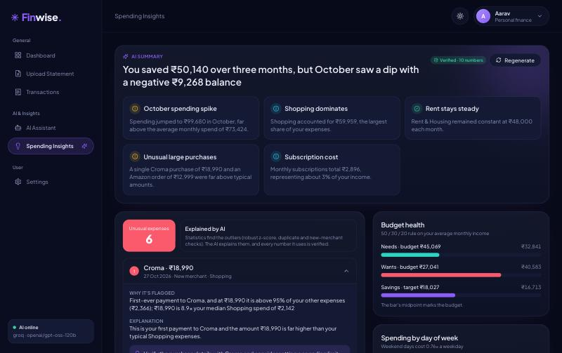
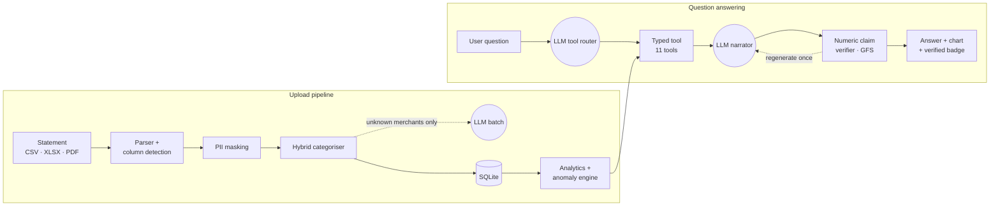

<div align="center">

# ✳ FinWise

### Intelligent Financial Transaction Explainer

**Upload a bank statement. Get plain-English answers about your money, with every number verified.**


</div>

---

## About

Bank and UPI statements tell you **what** you spent, never **why**. A typical narration looks like `UPI/DR/4123../SWIGGY/okaxis/Payment`, and a statement has hundreds of them a month. Expense trackers turn these rows into pie charts. General chatbots can explain them, but given a raw statement they **invent totals and percentages**.

**FinWise** is an LLM-powered financial transaction explainer. It:

- 📄 **Ingests** CSV, Excel and PDF statements from Indian banks (UPI / NEFT / POS / ACH formats)
- 🏷️ **Categorises** every transaction into 15 categories, including long-tail local merchants
- 🚨 **Explains unusual expenses**: spending spikes, duplicate charges and large first-time merchants
- 📈 **Finds spending patterns**: subscriptions, upcoming bills, weekday vs weekend, month-over-month change
- 💬 **Answers questions** in plain English, for example *"Why was October so expensive compared to September?"*
- ✅ **Verifies every ₹ amount and % the AI writes** before you see it

> **Core idea:** *the LLM explains, it never calculates.* Deterministic analytics compute every number. The LLM only picks the right analysis and narrates the result. A verifier then checks every number in the answer against the computed facts.

This is an LLM mini project from the Department of CSE, Dayananda Sagar University, Bengaluru. An accompanying 6-page IEEE conference paper and a presentation are in [`finwise/paper`](finwise/paper) and [`finwise/ppt`](finwise/ppt).

---

## Screenshots

| Dashboard | AI Assistant |
|---|---|
|  |  |

| Spending Insights (AI summary, verified) |
|---|
|  |

---

## What makes it novel

| Contribution | What it does | Result |
|---|---|---|
| **Grounded Explain-then-Verify** | Deterministic facts → LLM narration → numeric claim verification → one feedback-guided regeneration | 100% of answers numerically grounded |
| **Grounded Faithfulness Score (GFS)** | New reference-free metric: share of numeric claims supported by computed facts, with no extra LLM calls | GFS 0.983 → 1.000 with the verifier |
| **Text-to-Analytics Q&A** | The LLM maps each question to one of 11 typed tools instead of reading the whole statement | Accuracy 25% → 90%, ≈5× fewer tokens |
| **Cost-aware hybrid categoriser** | Merchant cache → 86 rule patterns → batched LLM for unknown merchants only, with PII masking | 97.2% accuracy, 49% fewer tokens than LLM-only |
| **Context-aware anomaly detector** | Robust (median/MAD) z-score + habitual-merchant suppression + duplicate and new-merchant rules | Finds 15/15 planted anomalies vs ≤6 for z-score baselines |

---

## Architecture



Square boxes are deterministic code and compute every number. Round nodes are LLM calls, used for language only, never for arithmetic.

---

## Tech stack

| Layer | Technologies |
|---|---|
| Backend | Python 3.12, FastAPI, pandas, pdfplumber, openpyxl, SQLite, Server-Sent Events |
| AI | Groq `openai/gpt-oss-120b` (default), Google Gemini (alternative), JSON mode, retries, response cache, rate limiting, offline fallback |
| Frontend | React 19, TypeScript, Vite, Tailwind CSS v4, Recharts, lucide-react, dark and light themes |
| Evaluation | scikit-learn, SciPy, matplotlib |
| Paper / slides | LaTeX (IEEEtran, Tectonic), pptxgenjs |

---

## Getting started

### Prerequisites
- **Python 3.11+**
- **Node.js 18+**
- A free API key from **[Groq](https://console.groq.com/keys)** (recommended) and/or **[Google AI Studio](https://aistudio.google.com/apikey)**. This is optional: without a key, FinWise runs in offline mode using rules and templates.

### 1. Clone
```bash
git clone https://github.com/dkadchha2845/FinWise.git
cd FinWise/finwise
```

### 2. Backend
```bash
cd backend
python3 -m venv .venv
.venv/bin/pip install -r requirements.txt
cp .env.example .env          # then paste GROQ_API_KEY and/or GEMINI_API_KEY into .env
.venv/bin/uvicorn app.main:app --port 8000 --reload
```

### 3. Frontend (in a second terminal)
```bash
cd frontend
npm install
npm run dev                   # opens http://localhost:5173 (proxies /api → :8000)
```

### Configuration (`backend/.env`)
| Variable | Default | Meaning |
|---|---|---|
| `LLM_PROVIDER` | `auto` | `auto` (Groq if key present, else Gemini, else offline), `groq`, `gemini` or `mock` |
| `GROQ_API_KEY` / `GROQ_MODEL` | – / `openai/gpt-oss-120b` | Groq credentials and model |
| `GEMINI_API_KEY` / `GEMINI_MODEL` | – / `gemini-3.8-flash` | Gemini credentials and model |
| `LLM_MIN_INTERVAL` | `0` | Seconds between LLM calls (set ≈2.5 on free tiers) |

---

## How to use

1. **Upload a statement:** open **Upload Statement** and drag in a CSV, Excel or text-based PDF export from your bank. To try it without real data, click one of the three **sample statements** (Aarav: CSV, Priya: Excel, Rohan: PDF).
2. **Read the dashboard:** health score (0–100) with reasons, this month's fixed vs flexible spending and savings, an unusual-expenses counter, cash flow over time, the category breakdown, upcoming bills and recent transactions.
3. **Open Spending Insights:** an AI summary and insight cards (each shows *Verified · N numbers*), every unusual expense with *why it was flagged*, an AI explanation and a suggested action, plus your 50/30/20 budget health, subscriptions, top merchants and month-over-month change.
4. **Ask the AI Assistant:** use the quick chips (*Spending, Suggest Budget, Upcoming Bills, Subscriptions, Unusual expenses, Compare months*) or type your own question:
   - *"How much did I spend on food in September?"*
   - *"Show me all Uber rides above ₹500"*
   - *"Why was October so expensive compared to September?"*
   - *"Suggest a monthly budget for me"*

   Each answer shows which analysis tool was used, an inline chart, and a verification badge.
5. **Fix a category:** in **Transactions**, change any category from the dropdown. FinWise applies it to every transaction from that merchant and remembers it for future uploads.

### Supported statement formats
Column names are detected automatically, including **Date / Txn Date / Value Dt**, **Narration / Description / Particulars**, separate **Withdrawal / Deposit** columns, a signed **Amount**, or **Amount + Dr/Cr**. Scanned (image-only) PDFs are not supported.

### Privacy
Before any text is sent to an LLM, FinWise masks account and reference numbers, UPI IDs, phone numbers, e-mails, PAN numbers and the names of people you pay. Known merchants are categorised locally, and all totals are computed on your machine.

---

## API reference

| Method | Endpoint | Description |
|---|---|---|
| `GET` | `/api/status` | LLM provider status, active statement, categories |
| `POST` | `/api/statements/upload` | Upload a statement (multipart `file`) → parse, mask, categorise, detect anomalies |
| `POST` | `/api/statements/sample/{aarav\|priya\|rohan}` | Load a sample statement |
| `GET` | `/api/statements` | List uploaded statements |
| `POST` | `/api/statements/{id}/activate` · `DELETE /api/statements/{id}` | Switch to / delete a statement |
| `GET` | `/api/dashboard` | Overview, trend, health score, anomalies, upcoming bills |
| `GET` | `/api/transactions?q=&category=&month=&anomalies_only=&sort=&page=` | Search and filter transactions |
| `PATCH` | `/api/transactions/{id}` | Re-categorise (applies to the merchant and is remembered) |
| `GET` | `/api/anomalies` | Unusual expenses with AI explanations |
| `GET` | `/api/insights?refresh=` | AI insight cards + patterns + budget |
| `POST` | `/api/chat` | Streaming (SSE) Q&A: `tool` → `token`… → `done` (verification) |

Interactive docs are at **http://localhost:8000/docs** while the backend is running.

---

## Evaluation

Run on a labelled dataset of **535 synthetic Indian transactions** (3 personas × 3 months, CSV/XLSX/PDF, 88 merchants, 15 planted anomalies) with `gpt-oss-120b` on Groq.

**Categorisation**

| Mode | Accuracy (95% CI) | Macro-F1 | LLM tokens |
|---|---|---|---|
| Rules only | 64.3% [60.2, 68.2] | 0.676 | 0 |
| LLM only | 93.3% [90.8, 95.1] | 0.858 | 13,319 |
| **Hybrid (FinWise)** | **97.2% [95.4, 98.3]** | **0.967** | **6,832** |

**Anomaly detection (F1)**

| Method | Ground-truth categories | Predicted categories |
|---|---|---|
| Global z-score | 0.571 | 0.435 |
| Per-category z-score | 0.476 | 0.545 |
| **FinWise detector** | **1.000** | **0.938** |

**Question answering (30 questions)**

| Strategy | Answer accuracy | Claim precision | Fully grounded | Tokens / question |
|---|---|---|---|---|
| Context stuffing (whole statement in prompt) | 25%* | 51.7% | 60% | 6,334 |
| Text-to-Analytics | 90% | 96.8% | 96.7% | ≈1,250 |
| **+ Numeric Claim Verifier** | **90%** | **100%** | **100%** | +3.3% calls |

\* 10 of 30 context-stuffing requests exceeded the API's per-request token limit. Fisher's exact test against Text-to-Analytics: p = 3.6×10⁻⁶.

Reproduce everything:
```bash
cd finwise/backend
.venv/bin/python scripts/generate_data.py   # regenerate sample statements + labels
.venv/bin/python -m eval.run                # → eval/results/{tables.md, results.json, *.png, qa_samples.json}
.venv/bin/python -m eval.run --offline      # only the experiments that need no API key
```

**Limitations.** The data is synthetic, and the detector thresholds were tuned on the same personas. The verifier checks numbers, not qualitative claims. A verified answer is faithful to the computed facts but can still inherit a wrong category.

---

## Project structure

```
FinWise/
├── finwise/
│   ├── backend/
│   │   ├── app/
│   │   │   ├── main.py          # FastAPI routes
│   │   │   ├── ingest.py        # CSV / XLSX / PDF parsing, column detection
│   │   │   ├── privacy.py       # PII masking
│   │   │   ├── categories.py    # taxonomy, rule dictionary, merchant extraction
│   │   │   ├── categorize.py    # hybrid cache → rules → batched LLM categoriser
│   │   │   ├── analytics.py     # aggregates, recurring, anomaly detector, health score, budget
│   │   │   ├── insights.py      # grounded explain-then-verify narration
│   │   │   ├── verify.py        # numeric claim verifier + GFS
│   │   │   ├── chat.py          # Text-to-Analytics router, tools, streaming answers
│   │   │   ├── llm.py           # Groq / Gemini client (OpenAI-compatible)
│   │   │   └── db.py            # SQLite persistence
│   │   ├── data/                # sample statements + ground-truth labels
│   │   ├── scripts/generate_data.py
│   │   ├── eval/                # evaluation harness and results
│   │   └── requirements.txt
│   ├── frontend/                # React + TypeScript + Tailwind UI
│   ├── paper/                   # IEEE conference paper (LaTeX + PDF)
│   └── ppt/                     # presentation (.pptx) + generator script
├── docs/                        # PRD and screenshots
└── LICENSE
```

---

## License

Released under the [MIT License](LICENSE).

> FinWise gives informational insights only and is not financial or investment advice.
